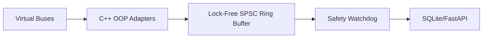

# surgical-telemetry-logger

## Architecture


Live Demo: https://arunkumar-explorer.github.io/surgical-telemetry-logger/

## Local Setup
```powershell
.\run.ps1
```
Open http://127.0.0.1:8000

## Tests
```bash
cd cpp_engine && g++ -std=c++17 -O2 -pthread src/protocol_adapter.cpp tests/test_engine.cpp -I include -o test_engine && ./test_engine
cd backend_sql && pytest -v
```
